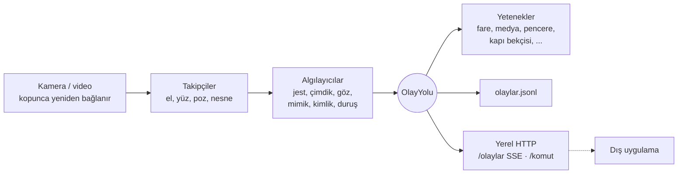

# Python CV: Bilgisayarlı Görü ile Bilgisayar Kontrolü


Standart bir web kamerası, OpenCV ve MediaPipe ile bilgisayarı elle, yüzle ve bedenle yöneten
sistemler **17 derste** adım adım geliştirildi. Her ders bir öncekinin üstüne kuruldu ve ortak
çekirdek paket [`goru`](goru/) (Bilgisayarlı **Görü**) her derste büyüdü. Son derste tüm
yetenekler 7/24 arka planda çalışan, başka uygulamalara eklenebilen tek bir servise dönüştü.

<!-- Demo GIF'i: docs/demo.gif kaydedip aşağıdaki satırın yorumunu kaldır -->
<!--  -->

## Dersler

| # | Ders | Öne çıkanlar |
|---|------|--------------|
| | **Faz 1: Eller** | |
| 1 | [El Kontrollü Fare V1](faz-1-mouse-kontrol/) | MediaPipe el iskeleti, çimdikle tıklama, yumrukla uyku modu |
| 2 | [Fare V2: Akışkanlık](dersler/ders_02_fare_v2/) | Takılmanın kök nedeni bulundu, 1€ filtresi, 144 Hz imleç thread'i |
| 3 | [Jest Merkezi ve Olay Yolu](dersler/ders_03_jest_merkezi/) | 7 statik jest + kaydırma, yayınla-abone ol mimarisi |
| 4 | [Medya ve Ses Kontrolü](dersler/ders_04_medya_kontrol/) | Parmak mesafesiyle ses seviyesi, jestle medya |
| 5 | [Güvenilir Çimdik ve Fare V3](dersler/ders_05_guvenilir_cimdik/) | 7 katmanlı çimdik, kişiye özel eşik örnekleyici |
| 6 | [Hologram Masası I](dersler/ders_06_hologram_masasi/) | Tarayıcıda 3D sahne: tut, fırlat, iki elle büyüt; karar Python'da, çizim three.js'te |
| 7 | [Hologram Masası II](dersler/ders_07_hologram_masasi_2/) | Pençeyle uzaktan çekme, alkış, Pepper's ghost piramit modu |
| 8 | [Kontrol Merkezi ve Hava Çizimi](dersler/ders_08_kontrol_merkezi/) | Fare / medya / pencere modları, iki parmakla kaydırma, parmakla çizim |
| | **Faz 2: Yüz** | |
| 9 | [Yüz İskeleti ve Baş Pozu](dersler/ders_09_bas_pozu/) | 478 nokta, matris ve solvePnP karşılaştırması, başla imleç |
| 10 | [Göz Kırpma ve Yorgunluk](dersler/ders_10_goz_kirpma/) | Uyarlanır EAR eşiği, göz kırparak tıklama, PERCLOS |
| 11 | [Mimik Komutları](dersler/ders_11_mimik/) | 52 ifade skoru, kendini düzelten nötr taban, el kapısı |
| | **Faz 3: Kimlik (Kapı Bekçisi)** | |
| 12 | [Yüz Tanıma](dersler/ders_12_yuz_tanima/) | YuNet + SFace, çeşitlilik zorunlu kayıt, yerel kimlik veritabanı |
| 13 | [Canlılık Testi](dersler/ders_13_canlilik/) | Fotoğrafa karşı rastgele hareket sorgusu |
| 14 | [Kapı Bekçisi](dersler/ders_14_kapi_bekcisi/) | Tanıma + canlılık, uzaklaşınca Windows kilidi, yabancı kaydı |
| | **Faz 4: Dünya** | |
| 15 | [Nesne Tespiti](dersler/ders_15_nesne_tespiti/) | EfficientDet, IoU ile ID takibi, parmakla gösterilen nesne |
| 16 | [Vücut Pozu](dersler/ders_16_vucut_pozu/) | Egzersiz sayacı, önden bakan kamerayla duruş bekçisi |
| | **Faz 5: Entegrasyon** | |
| 17 | [7/24 Servis](dersler/ders_17_servis/) | Paralel ön / arka plan, enerji tasarrufu, HTTP + SSE, kontrol paneli |

Ayrıntılı müfredat: [YOL_HARITASI.md](YOL_HARITASI.md) · Hangi hareket ne yapar: [OZELLIKLER.md](OZELLIKLER.md)

## Kodu nasıl okumalı?

Bütün kod ve açıklamalar Türkçedir. Her modülün başında ne işe yaradığını anlatan bir açıklama,
her sınıf ve fonksiyonun altında kısa bir docstring vardır. Önerilen okuma sırası:

1. Dersin kendi dosyası (`dersler/ders_NN_*/`): başındaki açıklama jestleri anlatır, `main()` altındaki
   açıklama dersin akışını adım adım verir. Dosya kısa tutuldu; asıl iş `goru/` paketindedir.
2. Dersin `README.md` dosyası: kavramlar, ölçümler ve kodun neden böyle yazıldığı.
3. Dersin kullandığı `goru/` modülü (aşağıdaki "Depo yapısı" tablosunda hangisi olduğu yazar).

Testler de bir belgedir: `tests/` altındaki sentetik veriler her modülün nasıl kullanılacağını gösterir.

## Ölçülen sonuçlar

| Ders | Ölçüm | Önce | Sonra |
|------|-------|------|-------|
| 2 | Döngü üst sınırı | ~10 FPS (`pyautogui.PAUSE` her çağrıda 100 ms uyutuyordu) | Kamera hızı |
| 2 | Dururken titreme / hızlı harekette gecikme | 0.0016 / %3.3 ekran | **0.0008 / %1.7 ekran** |
| 5 | Gerçek videoda sahte çimdik başlangıcı (yumruk, yüze dokunma) | 12 | **2** |
| 11 | Gerçek videoda kasıtsız ifade komutu | 3 | **1** |
| 12 | Kosinüs benzerliği: aynı kişi / farklı kişiler | | **0.95-0.97 / 0.01-0.24** |
| 13-14 | Fotoğrafla kapıyı açma | Yüz tanıma tek başına kandırılır | **Canlılık testinde reddedilir** |
| 17 | Servis, fare tarafında kare başına süre (kontrol + yorgunluk) | 44 ms | **21.6 ms (~46 FPS)** |
| 17 | Servis, 5 yetenek birden | 72 ms | **34 ms**; ağır işler arka planda kare atlar |

## Mimari



Görüntü modülleri sadece **ne olduğunu** yayınlar (`jest.degisti`, `yorgunluk.uyari`,
`kapi.acildi`...). Ne yapılacağına aboneler karar verir. Başka bir uygulama da aynı olaylara
abone olarak bu modülü kendi özelliği gibi kullanabilir: [Ders 17](dersler/ders_17_servis/#başka-bir-uygulamaya-entegrasyon).

**Açık kaynak referans:** El ile hologram arayüzü tasarımı [barehands](https://github.com/jaredrhod/barehands)
projesinden esinlendi; teknikler incelendi, kod bu repo için piksel uzayında yeniden yazıldı:
[docs/referanslar/barehands_analizi.md](docs/referanslar/barehands_analizi.md)

## Kurulum

```bash
git clone https://github.com/YusufTaha-Kurt/Python_CV.git
cd Python_CV
python -m venv .venv
.\.venv\Scripts\activate          # Mac/Linux: source .venv/bin/activate
pip install -r requirements.txt   # goru paketini de kurar
```

Modeller (toplam ~70 MB) ilk kullanımda `models/` klasörüne otomatik indirilir.

## Çalıştırma

```bash
python baslat.py                  # Tüm dersler menüden
python baslat.py 5 --sadece-izle  # Ders 5'i fareye dokunmadan dene
```

Hangi el hareketinin ne yaptığını unutursan [OZELLIKLER.md](OZELLIKLER.md) dosyasına bak.

Her ders aynı seçenekleri destekler:

| Seçenek | İşi |
|---------|-----|
| `--sadece-izle` | Fareye, klavyeye ve sese dokunmadan dene (**ilk denemede önerilir**) |
| `--kaynak 1` | Başka bir kamera, ya da `--kaynak kayit.mp4` ile video / görsel dosyası |
| `--pencere-yok` | Görüntü penceresi açmadan çalış |
| `--kare-limiti 300` | Bu kadar kare işleyip çık |

Pencerede **q** ya da **ESC** çıkış yapar.

## Testler

```bash
pytest -m "not uctan_uca"   # Birim testleri: kamera ve model gerekmez, CI'da çalışır
pytest -m uctan_uca         # Her dersi gerçek modellerle videolar / fotoğraflar üzerinde çalıştırır
pytest                      # Hepsi (164 test)
```

Birim testleri sentetik el, yüz ve vücut verisiyle çalışır: çimdik katmanları, hologram fiziği,
pençe jesti, göz kırpma türleri, canlılık testi, kapı bekçisi, nesne takibi, servis. Uçtan uca
testler örnek fotoğraflardan video üretip her dersi gerçek MediaPipe ve OpenCV modelleriyle
çalıştırır; örneğin bir fotoğrafla kayıt olup aynı fotoğrafla kapıyı açmaya çalışır ve reddedildiğini doğrular.

## Depo yapısı

```
goru/                     Ortak çekirdek paket
  kamera.py, uygulama.py    Kare kaynağı (kamera / video / görsel) ve ders iskeleti
  el.py, yuz.py, poz.py     MediaPipe el (21), yüz (478 + 52 ifade), vücut (33) takibi
  nesne.py, takip.py        EfficientDet nesne tespiti, IoU ile ID takibi
  jestler.py, cimdik.py     Jestler, kaydırma, 7 katmanlı güvenilir çimdik
  filtreler.py, imlec.py    1€ filtresi, 144 Hz imleç sürücüsü
  fare.py, kisayollar.py    Tıklama durum makinesi, kaydırma, pencere kısayolları
  medya.py, ses.py          Jestle medya ve sistem sesi
  hologram.py, web.py       Hologram masası mantığı, yerel MJPEG / SSE sunucusu
  bas_pozu.py, goz.py       Baş pozu, göz kırpma, yorgunluk
  mimik.py                  Yüz ifadesi komutları
  kimlik.py, canlilik.py    Yüz tanıma, canlılık testi
  kapi.py                   Kapı bekçisi durum makinesi
  egzersiz.py               Eklem açıları, tekrar sayacı, duruş bekçisi
  yetenekler.py, servis.py  7/24 servis ve yetenekleri
  olaylar.py, hud.py        Olay yolu, ekran göstergeleri
dersler/                  Ders 2-17 (her biri kendi README'siyle)
faz-1-mouse-kontrol/      Ders 1 (V1, arşiv)
tests/                    Birim ve uçtan uca testler
docs/referanslar/         İncelenen açık kaynak projelerin analizleri
baslat.py                 Ders menüsü
```

## Gizlilik

Her şey bu bilgisayarda çalışır; görüntü hiçbir yere gönderilmez. Yerel sunucular sadece
`127.0.0.1`'e bağlanır. Yüz tanıma vektörleri (`kimlikler/`), ayarlar, kayıtlar ve modeller
`.gitignore`'dadır.
