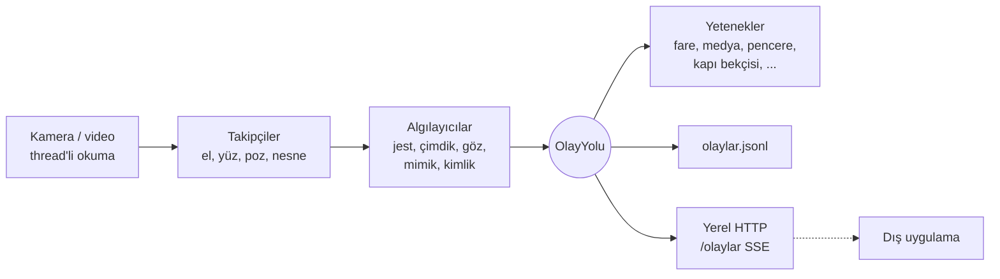

# Python CV: Bilgisayarlı Görü ile Bilgisayar Kontrolü


Standart bir web kamerası, OpenCV ve MediaPipe ile bilgisayarı elle, yüzle ve bedenle yöneten
sistemler **ders ders** geliştirilir. Her ders bir öncekinin üstüne kurulur ve ortak çekirdek
paket [`goru`](goru/) (Bilgisayarlı **Görü**) her derste büyür. Son derste tüm yetenekler
7/24 arka planda çalışabilen, başka uygulamalara eklenebilen tek bir servise dönüşür.

<!-- Demo GIF'i: docs/demo.gif kaydedip aşağıdaki satırın yorumunu kaldır -->
<!--  -->

## Dersler

| # | Ders | Durum | Öne çıkanlar |
|---|------|-------|--------------|
| 1 | [El Kontrollü Fare V1](faz-1-mouse-kontrol/) | ✅ | MediaPipe el iskeleti, çimdikle tıklama, yumrukla uyku modu |
| 2 | [Fare V2: Akışkanlık](dersler/ders_02_fare_v2/) | ✅ | 1€ filtresi, 144 Hz imleç thread'i, takılmanın kök nedeninin bulunması |
| 3 | [Jest Merkezi ve Olay Yolu](dersler/ders_03_jest_merkezi/) | ✅ | 7 statik jest + kaydırma, olay tabanlı mimari, JSONL olay akışı |
| 4 | [Medya ve Ses Kontrolü](dersler/ders_04_medya_kontrol/) | ✅ | Parmak mesafesiyle ses seviyesi, jestle medya kontrolü |
| 5 | [Güvenilir Çimdik ve Fare V3](dersler/ders_05_guvenilir_cimdik/) | ✅ | 7 katmanlı çimdik: gerçek videoda sahte çimdik 12 → 2, kişiye özel eşik örnekleyici |
| 6 | [Hologram Masası I](dersler/ders_06_hologram_masasi/) | ✅ | Tarayıcıda 3D sahne: kartları tut, fırlat, iki elle büyüt; karar Python'da, çizim three.js'te |
| 7 | [Hologram Masası II](dersler/ders_07_hologram_masasi_2/) | ✅ | Pençeyle uzaktan çekme, alkış, 3D model patlatma, piramit hologram modu |
| 8 | Kontrol Merkezi ve Hava Çizimi | ⏳ | Kaydırma, sanal masaüstü, mod makinesi, parmakla çizim |
| 9 | Yüz İskeleti ve Baş Pozu | ⏳ | 478 yüz noktası, `solvePnP`, başla imleç |
| 10 | Göz Kırpma ve Yorgunluk | ⏳ | EAR, göz kırparak tıklama, PERCLOS yorgunluk alarmı |
| 11 | Mimik Komutları | ⏳ | 52 ifade skoru, nötr yüz kalibrasyonu |
| 12 | Yüz Tanıma | ⏳ | YuNet + SFace, kosinüs benzerliği |
| 13 | Canlılık Testi | ⏳ | Fotoğrafla kandırmaya karşı hareket sorgusu |
| 14 | Kapı Bekçisi | ⏳ | Tanıma + canlılık, uzaklaşınca Windows'u kilitleme |
| 15 | Nesne Tespiti | ⏳ | EfficientDet, IoU takibi, işaret edilen nesne |
| 16 | Vücut Pozu | ⏳ | Eklem açıları, egzersiz sayacı, duruş bekçisi |
| 17 | 7/24 Servis | ⏳ | Eklenti yetenekler, enerji tasarrufu, yerel HTTP arayüzü |

Ayrıntılı müfredat: [YOL_HARITASI.md](YOL_HARITASI.md)

## Ölçülen iyileştirmeler (V1 → V2)

| Metrik | V1 | V2 | Nasıl |
|--------|----|----|-------|
| Döngü üst sınırı | ~10 FPS | Kamera hızı (30-60 FPS) | `pyautogui.PAUSE` her çağrıda 100 ms uyutuyordu, kapatıldı |
| İmleç güncelleme hızı | Kamera FPS'i | 144 Hz | Ayrı thread'de zamandan bağımsız üstel yaklaşma |
| Dururken titreme | 0.0016 | **0.0008** (2 kat az) | Sabit yumuşatma yerine 1€ filtresi |
| Hızlı harekette gecikme | %3.3 ekran | **%1.7 ekran** (2 kat az) | 1€ filtresinin hıza duyarlı kesim frekansı |
| Model çıkarımı | Her karede tam tespit | Kareler arası takip, ~11 ms/kare | MediaPipe `VIDEO` modu |
| Tıklama eşiği | Sabit 25 px | El boyutuna oranlı + histerezis | Kameraya uzaklıktan bağımsız |

Titreme ve gecikme değerleri [`tests/test_filtreler.py`](tests/test_filtreler.py) içindeki
sentetik sinyal deneyinden gelir (ekran genişliğine oranla, 30 FPS).

## Mimari



Görüntü modülleri sadece **ne olduğunu** yayınlar (`jest.degisti`, `jest.kaydirma`, `el.kayboldu`).
Ne yapılacağına aboneler karar verir. Başka bir uygulama da aynı olaylara abone olarak bu
modülü kendi özelliği gibi kullanabilir.

## Kurulum

```bash
git clone https://github.com/YusufTaha-Kurt/Python_CV.git
cd Python_CV
python -m venv .venv
.\.venv\Scripts\activate          # Mac/Linux: source .venv/bin/activate
pip install -r requirements.txt   # goru paketini de kurar
```

Model dosyaları ilk çalıştırmada `models/` klasörüne otomatik indirilir.

## Çalıştırma

```bash
python dersler/ders_02_fare_v2/fare_v2.py            # Fare V2
python dersler/ders_02_fare_v2/fare_v2.py --sadece-izle
python dersler/ders_03_jest_merkezi/jest_merkezi.py  # Jest merkezi
python dersler/ders_04_medya_kontrol/medya_kontrol.py
pytest                                               # Testler
```

Her ders aynı seçenekleri destekler:

| Seçenek | İşi |
|---------|-----|
| `--kaynak 1` | Başka bir kamera, ya da `--kaynak kayit.mp4` ile video / görsel dosyası |
| `--sadece-izle` | Fareye, klavyeye ve sese dokunmadan dene |
| `--pencere-yok` | Görüntü penceresi açmadan çalış |
| `--kare-limiti 300` | Bu kadar kare işleyip çık |

## Testler

```bash
pytest -m "not uctan_uca"   # Hızlı birim testleri (kamera ve model gerekmez, CI'da da çalışır)
pytest -m uctan_uca         # Her dersi gerçek modellerle bir video üzerinde çalıştırır
```

## Depo yapısı

```
goru/                   Ortak çekirdek (her derste büyür)
  kamera.py             Kamera / video / görsel kaynağı, kopunca yeniden bağlanma
  uygulama.py           Derslerin ortak iskeleti (argümanlar, kare döngüsü, pencere)
  el.py                 MediaPipe el takibi (VIDEO modu)
  jestler.py            Parmak durumları, çimdik, jestler, kaydırma, jest yayıncısı
  filtreler.py          1€ filtresi
  imlec.py              144 Hz akıcı imleç sürücüsü
  olaylar.py            Olay yolu + JSONL kaydedici
  ses.py, medya.py      Sistem sesi, medya tuşları ve jestle medya kontrolü
  hud.py                Ekran üstü göstergeler
dersler/                Ders 2'den itibaren her ders kendi klasöründe
faz-1-mouse-kontrol/    Ders 1 (V1, arşiv)
tests/                  Birim ve uçtan uca testler
docs/referanslar/       İncelenen açık kaynak projelerin analizleri
```
