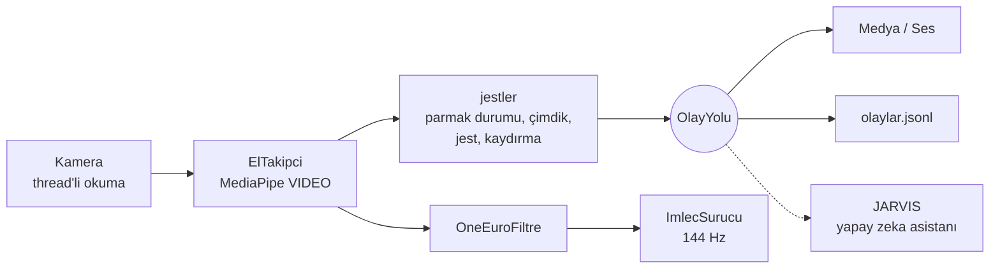

# J.A.R.V.I.S. Vision: Bilgisayarlı Görü ile Bilgisayar Kontrolü


> "Sometimes you gotta run before you can walk." - Tony Stark

Bu depo, kendi yapay zeka asistanımı (JARVIS) inşa etme yolculuğumun **görme** katmanıdır.
Standart bir web kamerası, OpenCV ve MediaPipe ile bilgisayarı elle, yüzle ve jestlerle
yöneten sistemler **ders ders** geliştirilir. Her ders bir öncekinin üstüne kurulur ve
ortak çekirdek paket [`jarvis_vision`](jarvis_vision/) her derste büyür.

<!-- Demo GIF'i: docs/demo.gif kaydedip aşağıdaki satırın yorumunu kaldır -->
<!--  -->

## Dersler

| # | Ders | Durum | Öne çıkanlar |
|---|------|-------|--------------|
| 1 | [El Kontrollü Fare V1](faz-1-mouse-kontrol/) | ✅ | MediaPipe el iskeleti, çimdikle tıklama, yumrukla uyku modu |
| 2 | [Fare V2: Akışkanlık](dersler/ders_02_fare_v2/) | ✅ | 1€ filtresi, 144 Hz imleç thread'i, takılmanın kök nedeninin bulunması |
| 3 | [Jest Merkezi ve Olay Yolu](dersler/ders_03_jest_merkezi/) | ✅ | 7 statik jest + kaydırma, olay tabanlı mimari, JSONL olay akışı |
| 4 | [Medya ve Ses Kontrolü](dersler/ders_04_medya_kontrol/) | ✅ | Parmak mesafesiyle ses seviyesi, jestle medya kontrolü |
| 5 | Güvenilir Çimdik ve Fare V3 | ⏳ | Yanlış tetiklemeye karşı 7 katmanlı çimdik, kişiye özel eşik örnekleyici |
| 6-7 | Hologram Masası | ⏳ | Tarayıcıda cam kartlar: tut, fırlat, iki elle büyüt, pençeyle uzaktan çek |
| 8 | Kaydırma, Pencere Yönetimi, Hava Çizimi | ⏳ | İki parmakla scroll, masaüstü değiştirme, mod sistemi |
| 9+ | Yüz, Kimlik, Ses ve Beyin | 🗺️ | Ayrıntılar: [YOL_HARITASI.md](YOL_HARITASI.md) |

## Ölçülen iyileştirmeler (V1 → V2)

| Metrik | V1 | V2 | Nasıl |
|--------|----|----|-------|
| Döngü üst sınırı | ~10 FPS | Kamera hızı (30-60 FPS) | `pyautogui.PAUSE` her çağrıda 100 ms uyutuyordu, kapatıldı |
| İmleç güncelleme hızı | Kamera FPS'i | 144 Hz | Ayrı thread'de zamandan bağımsız üstel yaklaşma |
| Dururken titreme | 0.0016 | **0.0008** (2 kat az) | Sabit yumuşatma yerine 1€ filtresi |
| Hızlı harekette gecikme | %3.3 ekran | **%1.7 ekran** (2 kat az) | 1€ filtresinin hıza duyarlı kesim frekansı |
| Model çıkarımı | Her karede tam tespit | Kareler arası takip, ~11 ms/kare | MediaPipe `VIDEO` modu |
| Tıklama eşiği | Sabit 25 px | El boyutuna oranlı + histerezis | Kameraya uzaklıktan bağımsız |

Titreme ve gecikme değerleri [`tests/test_filtreler.py`](tests/test_filtreler.py) içindeki
sentetik sinyal deneyinden gelir (ekran genişliğine oranla, 30 FPS).

## Mimari



Görüntü modülleri sadece **ne olduğunu** yayınlar (`jest.degisti`, `jest.kaydirma`, `el.kayboldu`).
Ne yapılacağına aboneler karar verir. İleride yapay zeka asistanı da bu olay yoluna
abone olan bir modül olarak bağlanacak.

## Kurulum

```bash
git clone https://github.com/YusufTaha-Kurt/Python_CV.git
cd Python_CV
python -m venv .venv
.\.venv\Scripts\activate          # Mac/Linux: source .venv/bin/activate
pip install -r requirements.txt   # jarvis_vision paketini de kurar
```

Model dosyaları ilk çalıştırmada `models/` klasörüne otomatik indirilir.

## Çalıştırma

```bash
python dersler/ders_02_fare_v2/fare_v2.py            # Fare V2
python dersler/ders_02_fare_v2/fare_v2.py --sadece-izle
python dersler/ders_03_jest_merkezi/jest_merkezi.py  # Jest merkezi
python dersler/ders_04_medya_kontrol/medya_kontrol.py
pytest                                               # Testler (kamera gerekmez)
```

## Depo yapısı

```
jarvis_vision/          Ortak çekirdek (her derste büyür)
  kamera.py             Thread'li, düşük gecikmeli kamera
  el.py                 MediaPipe el takibi (VIDEO modu)
  jestler.py            Parmak durumları, çimdik, jestler, kaydırma (saf numpy)
  filtreler.py          1€ filtresi
  imlec.py              144 Hz akıcı imleç sürücüsü
  olaylar.py            Olay yolu + JSONL kaydedici
  ses.py                Sistem sesi ve medya tuşları
  hud.py                Stark tarzı ekran göstergeleri
dersler/                Ders 2'den itibaren her ders kendi klasöründe
faz-1-mouse-kontrol/    Ders 1 (V1, arşiv)
tests/                  Kamerasız birim testleri
```
