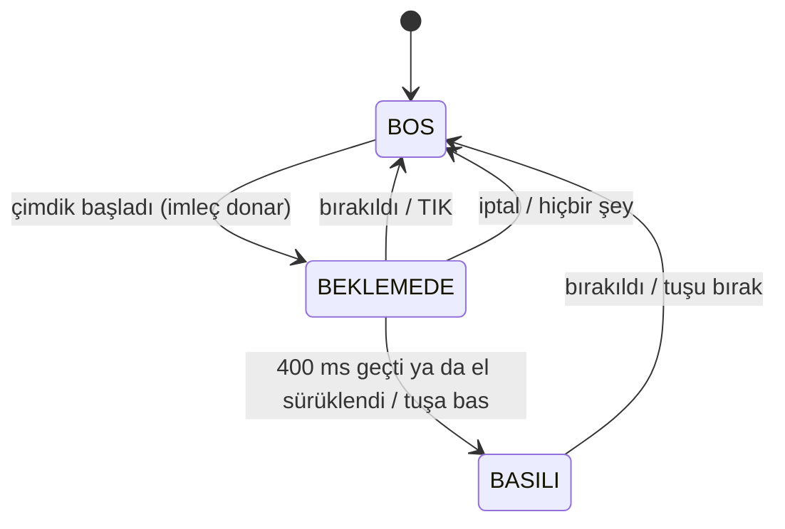

# Ders 5: Güvenilir Çimdik ve Fare V3

**Amaç:** Yanlış tıklamaları ortadan kaldırmak. Ders 2'nin çimdik algılayıcısı sadece "iki
parmak ucu yakın mı?" diye bakıyordu. Yumruk yapan, ellerini kenetleyen ya da yüzüne dokunan
bir el de bu testi geçer.

## Problem: gerçek veriyle

Ders 1 döneminde kaydedilmiş 10 saniyelik bir webcam videosunda (bilinçli çimdik yok; yumruk,
yüze dokunan el, kapüşon ipini tutan el var) iki algılayıcıyı karşılaştırdım:

| | Çimdik başlangıcı | Sonuç |
|---|---|---|
| V2 (mesafe + histerezis) | **12** | Her biri bir tuş basışı |
| V3 (`GuvenilirCimdik`) | **2** | Biri deneme süresinde iptal, biri kapüşon ipini gerçekten tutan el |

Kalan tek başlangıç fiziksel olarak gerçek bir çimdik: hiçbir sistem niyeti göremez, bunun
için uyku modu var. Kendi videonla denemek için:

```bash
python dersler/ders_05_guvenilir_cimdik/karsilastir.py --kaynak kayit.mp4
```

## Yedi katman

Fikirler [barehands](../../docs/referanslar/barehands_analizi.md) projesinden esinlendi; kod
ve eşikler piksel uzayında yeniden yazıldı ([cimdik.py](../../goru/cimdik.py)).

| # | Katman | Neyi engeller |
|---|--------|---------------|
| 1 | **Kontrast yasası.** Çimdik parmağı kıvrılır, diğer üç parmak dışarıda kalır ("OK işareti"). Ölçü: diğer parmakların ortalama `uç-bilek / kök-bilek` oranı eksi çimdik parmağının oranı | Yumruk, kenetlenmiş eller |
| 2 | **İki kare onayı + üstel ortalama** | Tek karelik şans eseri imza |
| 3 | **İmkânsız geometri.** Avuç en-boy oranı > 8 | Takip modelinin uydurduğu el şekilleri (yüze dokunan el) |
| 4 | **Hayalet kapısı.** El boyunun 4.5 katından hızlı hareket ederken doğan çimdik kavrayamaz, yavaşlayınca kendini iyileştirir | El sallarken bulanıklaşan parmaklar |
| 5 | **Hıza duyarlı bırakma.** Hızlı elde bırakma eşiği 0.55'ten 0.70'e çıkar ve iki kare art arda açık görülmelidir | Sürüklerken sahte bırakma |
| 6 | **Deneme süresi.** Yeni çimdik ilk 400 ms boyunca imzasını korumalı | Eli yumruk yaparken bir an OK işaretinden geçmek |
| 7 | **Histerezis.** Başlama eşiği bırakma eşiğinden küçük | Eşik etrafında titreme |

Ayrıca el takipçisi artık yeni el bulmak için yüksek (0.7), bulunmuş eli tutmak için düşük (0.5)
güven eşiği kullanıyor: kalabalık arka planda hayalet el çıkmıyor, hızlı harekette el kaybolmuyor.

### Koordinat uzayı tuzağı

barehands eşiklerini MediaPipe'ın normalize koordinatlarında ölçer (x ve y ayrı ayrı 0-1).
16:9 bir görüntüde bu uzayda yatay mesafeler ~1.78 kat küçük görünür. Avuç en-boy oranının
eşiği (barehands: 6) piksel uzayında aynen kullanılsaydı, kameraya yan dönen gerçek elleri de
reddederdi: gerçek video verisinde gerçek ellerin %5'i piksel uzayında 5.7'nin üstündeydi.
Eşik, aynı veride 8 olarak belirlendi.

## Tıklama durum makinesi



Ders 2'de çimdik başlar başlamaz tuşa basılıyordu. Şimdi kısa çimdikler bırakıldıkları anda
tık olur (işletim sistemleri tıkı zaten bırakma anında işler, gecikme hissedilmez). Tuşa ancak
çimdik deneme süresini atlatınca ya da el sürüklenince basılır. İptal edilen çimdik hiçbir
iz bırakmaz.

## Jestler

| Hareket | Sonuç |
|---------|-------|
| OK çimdiği (kısa) | Sol tık, iki kez hızlı: çift tık |
| OK çimdiği (basılı tut, elini kaydır) | Sürükle-bırak |
| Başparmak + orta parmak | Sağ tık |
| Yumruk (0.5 sn) | Uyku modu aç / kapa |

> **Önemli:** Çimdik artık OK işaretiyle yapılır. Orta, yüzük ve serçe parmaklar açık kalmalı.
> Eski usul (diğer parmaklar kıvrık) çimdik istersen `ayarlar/cimdik.json` içinde
> `"kontrast_zorunlu": false` yap.

## Kendi elinle ayarla

1. `python dersler/ders_05_guvenilir_cimdik/fare_v3.py --sadece-izle`
2. **p** tuşuna bas, 4 saniye boyunca OK çimdiği yap.
3. **y** tuşuna bas, 4 saniye boyunca başparmağın işaret parmağının üstünde olacak şekilde yumruk yap.
4. **k** tuşuna bas. Örnekleyici iki dağılımı en iyi ayıran eşikleri (aralarındaki boşluğun
   ortası) hesaplar ve `ayarlar/cimdik.json` dosyasına kaydeder. Fare V3 ve hologram masası
   bu dosyayı otomatik yükler.

**d** tuşu ölçümleri canlı gösterir: `oran`, `kontrast`, `arka`, `en_boy`, hız ve imza.

## CV maddesi

> El kontrollü farede yanlış tıklamaları ölçtüm (10 sn'lik gerçek videoda 12 sahte çimdik) ve
> açık kaynak bir projeden uyarladığım 7 katmanlı bir algılayıcı ile 2'ye indirdim. Eşikleri
> anizotropik normalize koordinatlardan piksel uzayına gerçek veriyle taşıdım; kullanıcının
> kendi eline göre eşik öneren bir örnekleyici ekledim.
