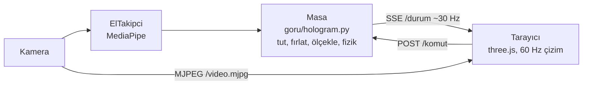

# Ders 6: Hologram Masası I

**Amaç:** Kamera görüntüsünün üstünde süzülen cam kartları ve 3D modelleri çıplak elle
yönetmek: tutmak, taşımak, fırlatmak, iki elle büyütmek, döndürmek, parçalarına ayırmak.
Kulaklık, eldiven ya da kumanda yok; sadece web kamerası.

Fikir [barehands](../../docs/referanslar/barehands_analizi.md) projesinden geliyor; o proje
her şeyi tarayıcıda (JavaScript) yapar. Burada farklı bir mimari seçildi.

## Mimari: karar Python'da, çizim tarayıcıda



- **Tüm etkileşim kararları Python'da** (`goru/hologram.py`). Kamera pikseli cinsinden
  çalışır ve **sentetik ellerle test edilir** (`tests/test_hologram.py`): tutma, dokunma,
  fırlatma ve sürtünme, iki elle ölçek, döndürme modu, patlatma.
- **Tarayıcı hiçbir karar vermez** (`goru/hologram_web/`). Gelen durumu 60 FPS'te çizer ve
  ~30 Hz'lik durum güncellemelerinin arasını yumuşatır (akışkanlık).
- **Sunucu sadece standart kütüphane** (`goru/web.py`): video MJPEG, durum SSE ile akar.
  Ek paket gerekmez. Sunucu sadece `127.0.0.1`'e bağlanır, dosyalar yalnızca kendi klasöründen
  verilir (`../` kaçışları testli), dışarıdan gelen komutlar izin listesiyle sınırlıdır.

## Hareketler

| Hareket | Sonuç |
|---------|-------|
| OK çimdiği ile tut | Taşı |
| Kısa çimdik (dokun) | Kartı aç / kapat, modeli patlat / topla |
| Tutup hızla bırak | Fırlat: son 0.25 sn'deki tepe hız aktarılır, sürtünmeyle yavaşlar, kenarlardan seker |
| İki elle aynı nesneyi tut | Büyüt / küçült (eller arası mesafe oranı) |
| Modeli tutup 1 sn sabit bekle | Döndürme modu: elini oynatarak modeli döndür |
| Boş çimdikle yana sürükle | Modelin parçalarını aç / kapat |

Çimdik Ders 5'teki `GuvenilirCimdik` ile algılanır: yumruk ya da yüze dokunan el bir şey
tutmaz, hızla sallanan el "hayalet" çimdiktir ve bir şey kavrayamaz.

## Çalıştırma

```bash
python dersler/ders_06_hologram_masasi/hologram_masasi.py
```

Tarayıcı otomatik açılır (`http://127.0.0.1:8765/`). Tarayıcıda **f** tam ekran, **h** yardımı
gizler, **p** piramit modu (Ders 7). Kapatmak için önizleme penceresinde **q** ya da terminalde Ctrl+C.

**Kendi içeriğin:** `icerik/` klasörüne `.md` dosyaları (ilk satır başlık olur) ve görseller
(`.png`, `.jpg`) bırak, masaya kart olarak gelirler. Ayrıca başka bir program
`POST /komut {"a": "kart_ekle", "baslik": "...", "govde": "..."}` ile masaya kart koyabilir.

## CV maddesi

> Web kamerasıyla çıplak elle yönetilen bir 3D arayüz geliştirdim: MediaPipe el takibi ve
> etkileşim fiziği Python'da, çizim three.js ile tarayıcıda. İkisini ek bağımlılıksız bir
> yerel sunucuyla (MJPEG + Server-Sent Events) bağladım; etkileşim mantığını sentetik el
> verisiyle birim testleri altına aldım.
