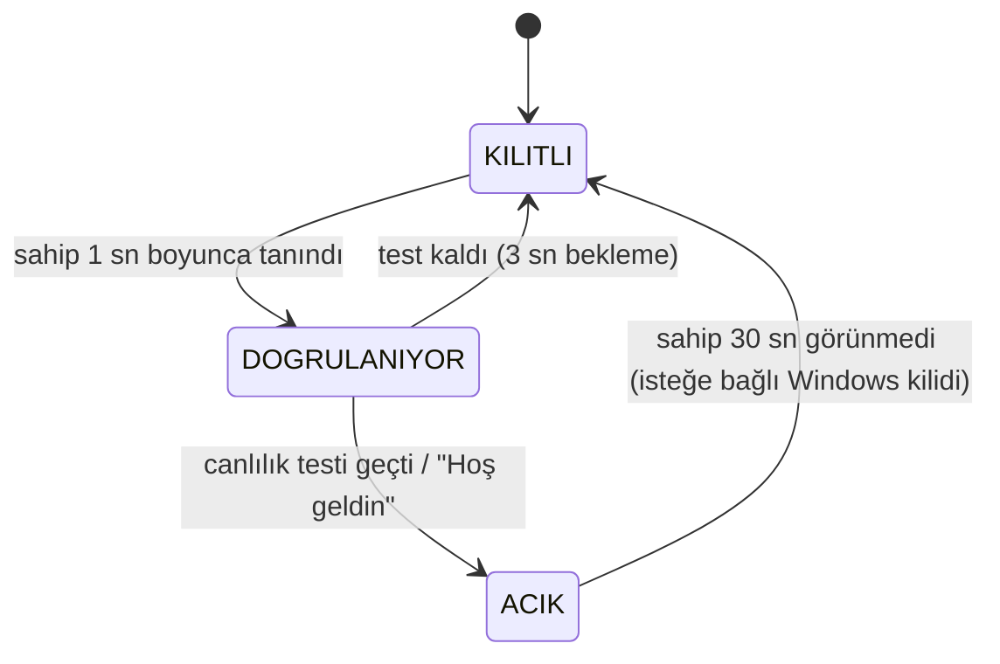

# Ders 14: Kapı Bekçisi

**Amaç:** Projenin ilk yol haritasındaki hedef: "Yüzümü gördüğünde 'Hoş geldin' deyip sanal
kapıyı açsın." Yüz tanıma (Ders 12) ve canlılık testi (Ders 13) bir durum makinesinde birleşir.

## Durum makinesi



Tanınmayan bir yüz 2 sn'den uzun görünürse `kapi.yabanci` olayı yayınlanır (30 sn'de bir);
`--yabanci-kaydet` ile o kare `guvenlik/` klasörüne kaydedilir.

**İşlemci tasarrufu:** Yüz tanıma her 2 karede bir çalışır; MediaPipe yüz modeli sadece
canlılık testi sırasında açılır.

**Başka modüllerle:** `KapiBekcisi.sahip_burada` özelliği, Ders 17'deki servisin "sadece
sahip bilgisayar başındayken jestleri dinle" ayarı için kullanılır.

## Kullanım

```bash
# 1. Kaydol
python dersler/ders_12_yuz_tanima/yuz_tanima.py --kaydet Yusuf
# 2. Kapıyı çalıştır
python dersler/ders_14_kapi_bekcisi/kapi_bekcisi.py
python dersler/ders_14_kapi_bekcisi/kapi_bekcisi.py --windows-kilitle --kilit-suresi 60 --yabanci-kaydet
```

`--windows-kilitle`: Sahip uzaklaşınca Windows oturumu kilitlenir (`LockWorkStation`).
Windows kilidini **açmak** kullanıcı programlarının yapabileceği bir şey değildir (bunun için
Windows Hello uyumlu kızılötesi kamera gerekir); bu yüzden kapı "sanal" kalır.

## Testler

- Birim: durum geçişleri, kilitleme süresi, canlılık reddi sonrası bekleme, yabancı uyarısı.
- Uçtan uca: Gerçek modellerle bir fotoğraftan kayıt yapılır, sonra aynı fotoğrafla kapı
  denenir: kişi **tanınır** (`kapi.dogrulaniyor`) ama canlılık testinde **reddedilir**
  (`kapi.reddedildi`), kapı açılmaz.

## CV maddesi

> Yüz tanıma ve canlılık testini bir durum makinesinde birleştirip, sahibi uzaklaşınca
> bilgisayarı kilitleyen ve yabancıları kaydeden bir "kapı bekçisi" yaptım; fotoğrafla
> açılmadığını uçtan uca testle doğruladım.
