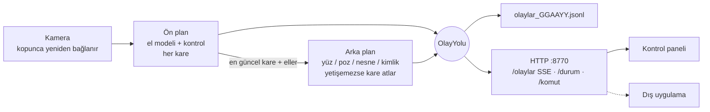

# Ders 17: 7/24 Servis

**Amaç:** Önceki derslerde ayrı ayrı çalışan yetenekleri, bilgisayar açık olduğu sürece arka
planda çalışan tek bir servise dönüştürmek ve başka uygulamaların bu servisi kendi özelliği
gibi kullanabilmesini sağlamak.

## Yetenekler

| Yetenek | Ders | Model | Çalışma sıklığı | Varsayılan |
|---------|------|-------|-----------------|------------|
| `kontrol` | 8 | El | Her kare, **ön plan** | Açık |
| `yorgunluk` | 10 | Yüz | 2 karede bir | Açık |
| `durus` | 16 | Poz | 3 karede bir | Kapalı |
| `mimik` | 11 | Yüz + el | 2 karede bir | Kapalı |
| `kapi` | 14 | YuNet + SFace (+ yüz, sadece doğrularken) | 2 karede bir | Kapalı |
| `nesne` | 15 | EfficientDet | 3 karede bir | Kapalı |

Ayarlar: [`servis_ayarlari.json`](servis_ayarlari.json). Yetenekler çalışırken kontrol
panelinden ya da HTTP komutuyla açılıp kapatılabilir.

## Mimari



### Akıcılık: iki iş parçacığı

İlk sürümde her şey tek iş parçacığında sırayla çalışıyordu: yüz ya da poz modeli
yavaşlayınca fare de yavaşlıyordu. Şimdi:

- **Ön plan** sadece akıcılık isteyen yetenekleri (fare / medya / pencere) çalıştırır.
- **Arka plan** her zaman en güncel kareyi alır; yetişemezse eski kareleri atlar.
- MediaPipe çıkarım sırasında Python'un GIL kilidini bıraktığı için ikisi gerçekten paralel çalışır.
- El modeli bir kez çalışır, sonuçları arka plana da verilir.

Gerçek bir webcam videosunda (640x480) ölçülen, fare tarafının kare başına süresi:

| Açık yetenekler | Sıralı (ilk sürüm) | Sıralı + seyrek modeller | **Paralel** |
|-----------------|--------------------|--------------------------|-------------|
| kontrol + yorgunluk (varsayılan) | 44 ms | 31 ms | **21.6 ms (~46 FPS)** |
| + duruş | - | 51 ms | **33.9 ms (~30 FPS)** |
| kontrol, yorgunluk, duruş, mimik, nesne | - | 72 ms | **34.0 ms (~29 FPS)** |

Son satırda arka plan 290 karenin 89'unu bilerek atladı; fare yine kamera hızında çalıştı.

### Enerji tasarrufu

Hiçbir modelde 15 saniye boyunca kimse görünmezse servis **bekleme moduna** geçer ve
saniyede sadece 2 kare işler. Biri görününce hemen tam hıza döner (`servis.bekleme` olayı).

### Dayanıklılık

- Kamera koparsa (USB çıkarıldı, başka uygulama aldı) 2 saniyede bir yeniden bağlanmayı dener.
- Bir yetenek 5 kez üst üste hata verirse kapatılır (`servis.hata`), diğerleri çalışmaya devam eder.
- Günlük: `servis_kayitlari/servis.log` (1 MB'da döner, 3 yedek), olaylar: `olaylar_GGAAYY.jsonl`.
- HTTP sunucusu sadece `127.0.0.1`'e bağlanır; komutlar izin listesiyle sınırlıdır.

### Kapı bekçisiyle birlikte

`kapi` yeteneği `"sadece_sahip": true` ile açıksa, `kontrol` ve `mimik` yetenekleri sadece
kayıtlı sahip kapıyı açtığında (tanıma + canlılık) çalışır. Bilgisayarın başına başkası
oturursa jestler hiçbir şey yapmaz.

## Çalıştırma

```bash
python dersler/ders_17_servis/servis.py                          # ayar dosyasıyla
python dersler/ders_17_servis/servis.py --onizleme --sadece-izle # önce böyle dene
python dersler/ders_17_servis/servis.py --yetenekler kontrol,yorgunluk,durus
```

Kontrol paneli: **http://127.0.0.1:8770/** (durum, yetenekleri aç / kapat, canlı olaylar).
Konsol penceresi olmadan çalıştırmak için `python` yerine `pythonw` kullan.

### Windows açılınca otomatik başlatma

Görev Zamanlayıcı ile, oturum açılınca (yolları kendi kurulumuna göre düzenle):

```powershell
schtasks /Create /TN "Python CV Servis" /SC ONLOGON /RL LIMITED /TR "\"C:\yol\Python_CV\.venv\Scripts\pythonw.exe\" \"C:\yol\Python_CV\dersler\ders_17_servis\servis.py\""
```

Kaldırmak için: `schtasks /Delete /TN "Python CV Servis" /F`

## Başka bir uygulamaya entegrasyon

### Aynı süreç (Python)

```python
from goru.servis import Servis, ayarlari_yukle

servis = Servis(ayarlari_yukle("dersler/ders_17_servis/servis_ayarlari.json"))
servis.yol.abone_ol("yorgunluk.uyari", lambda olay: print("Mola ver:", olay.veri))
servis.yol.abone_ol("jest.degisti", lambda olay: print(olay.veri["el"], olay.veri["jest"]))
servis.baslat()                                   # Arka planda çalışır
servis.komut({"a": "yetenek_ac", "ad": "durus"})  # Çalışırken yetenek aç
...
servis.durdur()
```

### Ayrı süreç (herhangi bir dil)

| İstek | Yanıt |
|-------|-------|
| `GET /olaylar` | Server-Sent Events: her olay bir `data: {...}` satırı |
| `GET /durum.json` | FPS, işlem süreleri, açık yetenekler ve durumları, bekleme modu |
| `POST /komut` | `{"a": "duraklat"}`, `{"a": "devam"}`, `{"a": "yetenek_ac", "ad": "nesne"}`, `{"a": "yetenek_kapat", "ad": "nesne"}` |

```python
import json, urllib.request

with urllib.request.urlopen("http://127.0.0.1:8770/olaylar") as akis:
    for satir in akis:
        if satir.startswith(b"data: "):
            olay = json.loads(satir[6:])
            print(olay["ad"], olay["veri"])
```

### Olay sözlüğü

| Olay | Veri |
|------|------|
| `el.goruldu`, `el.kayboldu` | `el` |
| `jest.degisti` | `el`, `jest`, `parmak_sayisi` |
| `jest.kaydirma` | `el`, `yon` |
| `mod.degisti` | `mod`, `onceki` |
| `kontrol.uyku` | `acik` |
| `medya.eylem`, `pencere.eylem` | `eylem` |
| `yorgunluk.uyari` | `tur` (`mikro_uyku`, `yorgunluk`, `esneme`), `perclos` |
| `durus.uyari` | `tur` (`kambur`, `egik_omuz`) |
| `vucut.jest` | `jest` (`eller_yukari`, `t_pozu`) |
| `mimik.ifade` | `ifade` |
| `kapi.dogrulaniyor`, `kapi.acildi`, `kapi.reddedildi`, `kapi.kilitlendi`, `kapi.yabanci` | `kisi`, `neden`, `durum` |
| `nesne.goruldu`, `nesne.kayboldu` | `id`, `nesne` |
| `servis.basladi`, `servis.durdu`, `servis.bekleme`, `servis.yetenek`, `servis.hata`, `servis.komut` | çeşitli |

## Testler

- Birim (`tests/test_servis.py`, kamerasız, sahte modellerle): sadece gereken modellerin
  yüklenmesi, seyrek çalışma, hatalı yeteneğin kapatılması, komutlar, bekleme modu, "sadece
  sahip" kısıtı ve **paralel çalışma** (ön plan yavaş modeli beklemiyor, arka plan eski kareleri atlıyor).
- Uçtan uca (`tests/test_uctan_uca.py`): Servis gerçek modellerle arka planda çalışırken başka bir
  program gibi HTTP'den bağlanılır: durum okunur, olay akışı dinlenir, yetenek kapatılır, izin
  listesi dışındaki komut reddedilir.

## CV maddesi

> Bilgisayarlı görü yeteneklerini, tek kamerayı paylaşan, gereksiz modelleri hiç yüklemeyen,
> ağır işleri ayrı iş parçacığına alarak fare akıcılığını koruyan (kare başına 44 → 22 ms),
> kimse yokken enerji tasarrufuna geçen ve kamera kopmasına dayanıklı bir 7/24 servise
> dönüştürdüm; yerel HTTP (SSE) ve Python API ile başka uygulamalara entegre edilebilir hale getirdim.
